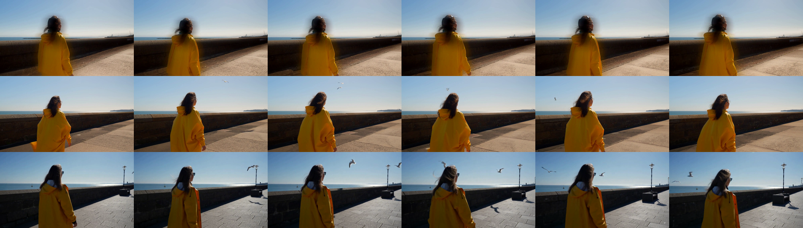
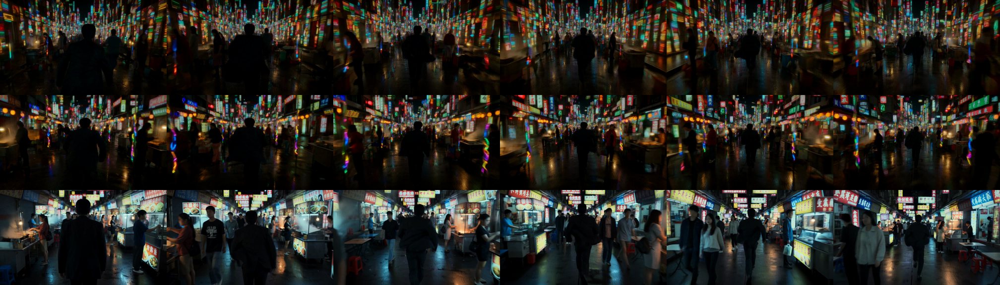
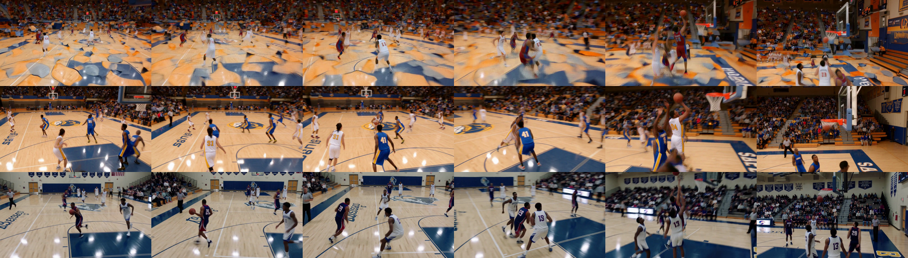

# MiniMax-H3 FL2VA 768p：BF16 Turbo 4 步 vs 8 步 vs 现网实测（2026-10-25）

## 0. 结论摘要

- **5s 短片（稳态）**：4 步 56–60 s、8 步 92–95 s、现网 104–107 s。
  4 步比 8 步快 **1.55–1.66×**，比现网快 **1.76–1.89×**。
- **15s 长片（热态）**：4 步 **223 s**、8 步 **373 s**、现网 **296–298 s**。
  4 步仍是最快，但优势从 1.8× 收窄到 **1.33×**；**8 步反而比现网慢 26%**。
- **必须用热态数据**：同一 15s 用例，整进程首请求是 379 s（4 步）/ 496 s（8 步），
  服务热起来之后只有 223 s / 373 s。**首请求含 123–156 s 的一次性预热**，直接拿它比较会得出相反结论
  （初版就因此误判成"现网更快"，已在 §3.3 更正）。
- **4 步不能当 8 步的等价加速**：同 seed 下 SSIM 只有 0.31–0.69，构图本身就换。
  且在**运动、暗光、复杂主体**三类场景出现可见崩坏（§6），不是风格差异。
- **显存不随步数变**：5s 19.7/19.8 GB、15s 25.9/27.1 GB，两档差 <1.5 GB。
  现网 INT8 更省：5s 18.5–19.5 GB、15s 22.0 GB。

## 1. 权重核实

NFS 上最新一批 lightx2v turbo 权重（`/nfs-models/wuhanjisuan894/models/MiniMax-H3-Turbo-LoRA/`），
2026-10-24 12:38–12:40 落盘，逐份解析 safetensors 头部：

| LoRA | 文件 | 体积 | 张量 | dtype | alpha | 完整性 |
| --- | --- | ---: | ---: | --- | ---: | --- |
| fl2v 4step v1.3 | `minimax_h3_fl2v_turbo_4step_v1.3_768p_bf16` | 1.38 GB | 624 | BF16 | 8 | 声明载荷 == 实际载荷 |
| fl2v 8step v1.1 | `minimax_h3_fl2v_turbo_8step_v1.1_768p_bf16` | 1.38 GB | 624 | BF16 | 8 | 同上 |
| ref2v 4step v1.0 | `minimax_h3_ref2v_turbo_4step_v1.0_768p_bf16` | 1.38 GB | 624 | BF16 | 8 | 同上 |
| ref2v 8step v1.1 | `minimax_h3_ref2v_turbo_8step_v1.1_768p_bf16` | 1.38 GB | 624 | BF16 | 8 | 同上 |

`rank 128 / alpha 8 → 缩放 0.0625`。四份都能在组装产物的 `model_index.json` 里查到烘焙校验：
312 对因子、208 个目标张量、10,063,872 个值、`max_abs_error=0.0`，烘焙前后 index sha256 相同。

组装产物：FL2VA Turbo4 v1.3、FL2VA Turbo8 v1.1、Ref2VA Turbo8 v1.1 齐全；
**Ref2VA Turbo4 v1.0 的 `-ref2va-vLLM` 目录缺失**，要跑该档需先补。

## 2. 评测协议

| 项 | 取值 |
| --- | --- |
| 用例 | 基础 7 条（`p1`–`p7`）+ 场景矩阵 13 条（`t8_s*` / `t9_s*`） |
| 分辨率 | 主用 1344×768；另测竖屏 768×1344、宽幕 1536×656、方形 1024×1024 |
| 时长 | 5s（主）/ 15s |
| seed | 42（三档相同） |
| 步数 | 请求显式指定 4 / 8，不依赖模型元数据默认 |
| BF16 配置 | `minimax_h3_fl2va_bf16_a100_40g.yaml`（FLASH_ATTN、TP4） |
| 现网配置 | `minimax_h3_singularity_vdn8_fl2va_a100_40g.yaml`（VDN_WINDOW_ATTN、8 步）+ `stage-dmd-step-250-curve-fl2va-baked2` |
| 现网基线来源 | **线上真实副本** `10.0.0.6:40011`（`MiniMax-H3-Singularity-VDN-INT8`） |

全部用例无参考图（纯文生视频），所以 keyframe 几何不参与，不构成混杂因素。
帧数逐条对齐：5s = 124 帧、15s = 362 帧、24 fps。

## 3. 延迟

### 3.1 5s 场景矩阵（热态）

服务已预热后逐条串行，单位秒：

| 场景 | 4 步 | 8 步 | 现网 | 4/8 | 现网/4 |
| --- | ---: | ---: | ---: | ---: | ---: |
| neon_night | 82 | 106 | 105 | 1.29 | 1.28 |
| underwater | 64 | 93 | 105 | 1.45 | 1.64 |
| two_people | 59 | 92 | 105 | 1.57 | 1.79 |
| sports | 59 | 95 | 105 | 1.60 | 1.77 |
| animal | 56 | 93 | 106 | 1.66 | 1.89 |
| small_text | 59 | 95 | 104 | 1.62 | 1.78 |
| rain | 59 | 92 | 104 | 1.56 | 1.76 |
| fabric | 60 | 95 | 107 | 1.59 | 1.80 |
| aerial | 59 | 94 | 106 | 1.59 | 1.81 |
| pov | 60 | 93 | 106 | 1.55 | 1.76 |

两点读数说明：

- **前两条仍偏慢**（neon 82/106、underwater 64/93）。只跑一条预热不够，第 2 条还在吃残余编译；
  从第 4 条起稳定在 4 步 56–60、8 步 92–95。
- **耗时与提示词内容无关**，同一档 10 个场景的离散度只有 ±4%。峰值内存也只随像素/帧数变。
  唯一例外是 neon（+23 s），发生在预热未完全收敛那条，不是内容效应。

### 3.1.1 从冷到热需要几条（5s，按执行顺序）

单位：4 卡整机墙钟秒。

| 档位 | 第 1 条 | 第 2 条 | 第 3 条 | 第 4 条起（稳态） | 到稳态需要 |
| --- | ---: | ---: | ---: | ---: | --- |
| BF16 4 步 | 188 | 82 | 65 | 59 / 59 / 57 / 59 | **3 条** |
| BF16 8 步 | 166 | 107 | 94 | 92 / 95 / 94 / 95 | **2–3 条** |
| 现网 8 步 | 106 | 105 | 106 | 105 / 106 / 105 | **第 1 条即热** |

结论：**正式记录前先空跑 3 条丢弃**（4 步必须 3 条；8 步 2 条够但 3 条更稳）。
现网没有这个问题，首条与稳态只差 1 s。

### 3.2 特殊比例（5s）

| 比例 | 4 步 cold | 4 步 hot | 8 步 cold | 8 步 hot |
| --- | ---: | ---: | ---: | ---: |
| 竖屏 768×1344 | 58 | 58 | 94 | 92 |
| 宽幕 1536×656 | 57 | 54 | 89 | 89 |
| 方形 1024×1024 | 58 | 59 | 94 | 94 |

**换宽高比几乎不付额外编译**（cold≈hot，差 ≤3 s）。耗时随总像素走，不随宽高比走。

### 3.3 15s 与"冷/热"更正

| 运行条件 | 4 步 | 8 步 | 现网 |
| --- | ---: | ---: | ---: |
| 整进程**首请求**（初版采用） | 379.1 s | 495.7 s | — |
| 服务已热、仅 15s 形状首次（cold） | 223.4 s | 375.3 s | — |
| **热态（本文采用值）** | **223.4 s** | **372.7 s** | **296 / 298.2 s** |

- 整进程预热成本 ≈ 4 步 **156 s**、8 步 **123 s**（CUDA 上下文、kernel autotune、图捕获）。
- 15s 这个形状本身**不需要额外编译**：cold 与 hot 相同（223/223、375/373）。
- 5s 首请求同样偏慢：4 步 188 s、8 步 166 s，稳态 59/93 → 编译成本 ≈ 129 s / 73 s。
  且第 2、3 条仍未收敛，详见 §3.1.1 的逐条收敛表。

> **更正**：初版用首请求数据得出了"15s 上现网比 4 步快 21%"。按热态重测，4 步 223 s、
> 现网 296 s，**4 步快 1.33×**。初版结论作废。

## 4. 资源占用

单卡显存（`summary.json` 逐秒采样取峰值；现网由 gpu23 上的独立采样器测）：

| 档位 | 5s 稳态 | 5s 首请求（冷） | 15s | 宿主内存峰值 |
| --- | ---: | ---: | ---: | ---: |
| BF16 4 步 | 19.7 GB | 24.4 GB | 25.9 GB | 185.7 GiB |
| BF16 8 步 | 19.8 GB | 24.4 GB | 27.1 GB | 186.6 GiB |
| 现网 INT8 | 18.5–19.5 GB | — | 22.0 GB | 138.6 GiB |

- **步数不影响显存**（两档差 <1.5 GB），省步数只省时间。
- **冷启动峰值比稳态高 4–5 GB**（24.4 vs 19.7）：图捕获的临时 arena。排容量要按冷启动算。
- **空闲画像与推理峰值差别很大**：推理结束后 GPU 回落到 **0.9 GB**，但宿主机**常驻 139 GB**
  （权重驻留 CPU 侧）。也就是说这 4 张卡虽然空着，**宿主内存没还回来**，
  想在同一台机器上再塞一个模型要先看 139 GiB 的余量。
- 三种 5s 比例显存一致（19.6–19.9 GB），说明显存随**总像素 × 帧数**而不是宽高比。
- 宿主内存 BF16 约 185 GiB / 251 GiB（74%），现网只要 139 GiB。
- 现网空闲回落到 7.4 GiB（VDN 分量 offload），推理峰值 22.0 GiB。

**整机耗时**（4 卡 TP4 墙钟，热态；批量 N 条即 N × 该值）：

| 长度 | 4 步 | 8 步 | 现网 | 4 步 vs 现网 |
| --- | ---: | ---: | ---: | ---: |
| 5s | 59 s | 93 s | 105 s | **快 44%** |
| 15s | 223 s | 373 s | 296 s | **快 25%** |

## 5. 画质：基础 7 条（4 vs 8 vs 现网）

指标为抽帧均值（亮度 / 饱和度 / 锐度 / 帧间运动）：

| 用例 | YAVG 4/8/现网 | SATAVG 4/8/现网 | 锐度 4/8/现网 | 运动 4/8/现网 |
| --- | --- | --- | --- | --- |
| p2_hands | 46.7 / 52.1 / 61.3 | 79.2 / 75.8 / 49.8 | 29.9 / 15.9 / 36.8 | 19.3 / 24.1 / 36.9 |
| p3_fire | 12.3 / 10.3 / 18.8 | 63.0 / 66.1 / 61.6 | 65.9 / 27.9 / 74.7 | 4.3 / 4.0 / 9.2 |
| p4_square | 105.8 / 109.6 / 107.7 | 38.5 / 35.7 / 22.4 | 70.4 / 46.4 / 52.4 | 2.7 / 2.5 / 6.3 |
| p5_multishot | 78.8 / 81.3 / 85.3 | 30.3 / 31.8 / 35.2 | 44.2 / 47.1 / 64.9 | 41.3 / 47.1 / 42.8 |
| p6_book | 99.1 / 96.9 / 96.8 | 35.9 / 34.8 / 18.1 | 381.6 / 183.8 / 390.1 | 22.2 / 22.9 / 30.5 |
| p7_promenade | 123.0 / 124.0 / 106.3 | 42.6 / 37.8 / 33.9 | 104.2 / 71.9 / 102.6 | 6.9 / 7.3 / 11.2 |
| p1_15s | 135.4 / 139.7 / 114.6 | 14.6 / 12.4 / 17.0 | 62.0 / 48.5 / 82.9 | 18.7 / 21.5 / 24.3 |

**4 步 vs 8 步**：饱和度 5/7 更高（+3%～+18%）；运动量 5/7 更小（−3%～−20%）；
亮度多数在 ±3.5% 内，极暗场景（p3 火光 +18.9%、p2 手部 −10.5%）偏离大。

**锐度指标不能当画质**：4 步在 6/7 更高（+28%～+136%），但逐张 1:1 复核发现是构图里
高频内容更多（火焰占比更大、书页文字更密），不是解析力。p6 的 381 vs 184 就是这样来的：


p7 的提示词点名要"短而硬的影子"和"两只海鸥"，逐帧核对：

| 要求 | BF16 4 步 | BF16 8 步 | 现网 8 步 |
| --- | --- | --- | --- |
| 人物左侧硬阴影 | **缺失** | 很弱 | **清晰可见** |
| 海鸥 | **0 只** | 2–3 只 | 3–4 只 |
| 码头环境（路灯、护栏、地面结构） | 几乎没有 | 少量 | **齐全** |



## 6. 画质：10 场景矩阵

### 6.1 指标

| 场景 | SATAVG 4/8/现网 | 运动 4/8/现网 | 锐度 4/8/现网 |
| --- | --- | --- | --- |
| neon_night | 66.2 / 61.2 / 42.1 | 24.2 / 28.2 / 43.3 | 97 / 47 / 91 |
| underwater | 77.6 / 75.3 / 59.0 | 6.5 / 9.3 / 14.6 | 78 / 99 / 103 |
| two_people | 50.1 / 47.0 / 36.8 | 3.0 / 3.8 / 8.4 | 56 / 52 / 89 |
| sports | 50.9 / 51.3 / 31.4 | 36.0 / 49.1 / 57.7 | 138 / 77 / 150 |
| animal | 62.2 / 65.4 / 40.1 | 3.0 / 3.7 / 19.2 | 32 / 40 / 225 |
| small_text | 18.7 / 20.0 / 22.2 | 17.9 / 16.2 / 24.8 | 92 / 69 / 117 |
| rain | 14.2 / 14.8 / 28.3 | 4.2 / 5.2 / 5.1 | 83 / 47 / 57 |
| fabric | 20.5 / 15.2 / 37.2 | 28.0 / 36.0 / 42.8 | 3.5 / 4.2 / 14.9 |
| aerial | 37.6 / 41.1 / 44.1 | 3.1 / 3.2 / 8.7 | 130 / 127 / 292 |
| pov | 49.7 / 50.0 / 31.7 | 34.9 / 41.7 / 53.9 | 1044 / 642 / 433 |

- **饱和度**：现网在 7/10 场景更低（更收敛），但 rain、fabric、aerial 三例相反。
  初版基于 5 条 p-case 说"现网一律更淡"，样本扩到 10 条后要收窄成"多数更收敛"。
- **运动量**：现网 9/10 更高，最多 p4 2.3×、animal 6.4×。这条比较稳。
- **锐度**：无单调序。pov 上 8 步 642 甚至高于现网 433；fabric 三档都低（3–15，织物本就低频）。
  **锐度只能当同构图下的相对参考，不能跨场景比较**。

### 6.2 目视抽查（三条，均单 seed）

**neon_night**：4 步**崩成抽象彩色条纹**，看不出街道；8 步勉强成形（有霓虹招牌、人影轮廓，
但结构混乱）；现网是正常的夜市街景（摊位、行人、可读招牌）。**4 步在此场景不可用。**

**underwater**：提示词明确要求"a free diver glides above a coral reef"。
**两档 BF16 都没画出潜水员**（空礁石，4 步更平、8 步细节稍多）；现网有潜水员、脚蹼、气泡与光柱。
两档一致缺失说明这是**蒸馏权重配方的遵从度代价，与步数无关**。

**sports**：4 步前段**严重拖影糊化**（球员与地板粘连）；8 步与现网都清楚。
注意此时 4 步锐度指标 138 还高于 8 步的 77——**指标与肉眼判断相反**，因为糊化+高对比噪点会抬高方差。





### 6.3 4 步 vs 8 步的结构漂移

同 seed 下 SSIM 0.31–0.69、PSNR 10.3–18.8 dB（对比现网）。这**不是"同画面更快"**，
是换了一条采样轨迹：构图、主体大小、镜头距离都会变。**不能拿 4 步去替换已验收的 8 步产出。**

## 7. 交叉验证

| 校验 | 结果 |
| --- | --- |
| 现网延迟（线上副本 vs 独立副本 `spec_v13`） | p3 106.5 s vs 106.3 s；15s 298.2 s vs 300.6 s |
| 现网 15s 复测 | 296 s，与首次 298.2 s 差 0.7% |
| 现网输出确定性 | `spec_v13` 与 `prodv2` 同 seed 输出 **sha256 逐字节相同** |
| 冷/热一致性 | 4 步 15s：cold 223.4 = hot 223.4；8 步：375.3 vs 372.7（差 0.7%） |

## 8. 选型建议

| 场景 | 建议 | 依据 |
| --- | --- | --- |
| 5s、简单场景、吞吐优先 | **4 步（v1.3）** | 59 s，比现网快 1.79×、省 44% 算力 |
| 5s、**运动/暗光/复杂主体** | **不要用 4 步** | sports 拖影、neon 崩成条纹、underwater 丢主体 |
| 5s、质量优先 | 现网 | 遵从度与稳定性最好 |
| **15s** | 4 步或现网，**不要用 8 步** | 4 步 223 s（1.33×）、8 步 373 s 比现网还慢 26% |
| 替换已验收的 8 步产出 | 不建议 | 同 seed 构图就变（SSIM 0.31–0.69） |

一句话：**4 步的价值是"简单场景 + 短片段"的吞吐；复杂场景和 8 步替换上都不成立。**

## 9. 复现命令

```bash
# 起服务（保持运行，勿删容器）
bash /nfs-output/h3_turbo_eval/start_fl2va_bake.sh t4v13 \
  /nfs-models/wuhanjisuan894/models/MiniMax-H3-FL2VA-Turbo4-768p-v1.3-BF16-vLLM 40601
bash /nfs-output/h3_turbo_eval/start_fl2va_bake.sh t8v11 \
  /nfs-models/wuhanjisuan894/models/MiniMax-H3-FL2VA-Turbo8-768p-v1.1-BF16-vLLM 40602

# 场景矩阵（预热 → 10 场景 → 3 种比例 cold/hot → 15s cold/hot）
bash /nfs-output/h3_turbo_eval/run_scen.sh t4v13 40601 /nfs-output/h3_turbo_eval/cases_sc4 h3cmp-t4v13
bash /nfs-output/h3_turbo_eval/run_scen.sh t8v11 40602 /nfs-output/h3_turbo_eval/cases_sc8 h3cmp-t8v11

# 现网基线（线上副本，注意会占用线上实例）
bash /nfs-output/h3_turbo_eval/run_scen_prod.sh

# 指标与对照图
python3 /nfs-output/h3_turbo_eval/analyze_turbo_ab.py \
  --variants t4v13,t8v11,prodv2 --baseline prodv2 \
  --cases t8_s02_neon_night,t8_s04_underwater,t8_s05_two_people,t8_s07_sports,t8_s12_animal,t9_s15_small_text,t9_s17_rain,t9_s19_fabric,t9_s20_aerial,t9_s24_pov \
  --out-root /nfs-output/h3_turbo_eval/ab_scen_3way
```

产物：`/nfs-output/h3_turbo_eval/results/<variant>_<case>/`（`request/summary/output/progress/samples`）、
指标日志 `ab_scen_3way.log`、逐用例拼图 `ab_scen_3way/sheet_*.png`、
现网显存采样 `prod_gpu_samples.csv`。

## 10. 局限与未决

1. **单 seed、单条**。场景矩阵每格只有 1 条（seed 42）。neon 崩坏、underwater 丢主体这类结论
   需要多 seed 复现才能当通过率；目前只能当"存在性证据"。
2. **现网自建副本起不来**：`gpu14` 上用与线上相同命令启动 `MiniMax-H3-Singularity-VDN-INT8`，
   装载 40 分钟后 `DiffusionWorker` 静默死亡，父进程 `EOFError`（`_launch_workers` 收管道时 EOF），
   dmesg 无 OOM、无 worker 堆栈，未复现未定位。本次现网基线因此改用线上真实副本，
   且与其独立副本输出逐字节一致，不影响结论。
3. **稳态需要预热**：5s 用例 4 步要 3 条、8 步要 2–3 条才收敛（§3.1.1）；现网首条即热。
   任何对外对比都要显式标注是第几条、以及冷/热，否则数字能差 3 倍（188 vs 59）。
4. **批量耗时按 4 卡整机墙钟乘条数**，本文所有秒数都是这个口径（TP4，4 卡并行跑一条）。
   既不是单卡耗时，也没有按 4 卡再乘一次。
5. **Ref2VA 链路未做**，且该链路 4 步 v1.0 的组装目录缺失。
6. 锐度用 Laplacian 方差，本报告已证明它在糊化场景会与肉眼判断相反（sports），
   只作同构图相对参考。
